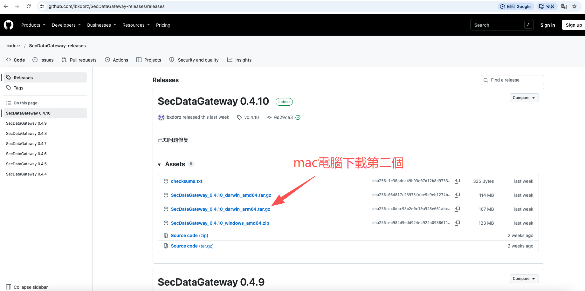
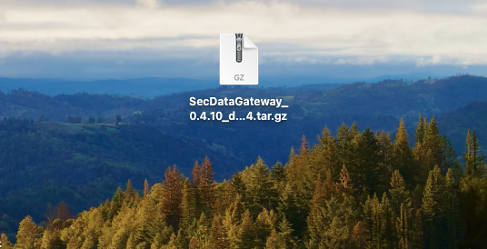
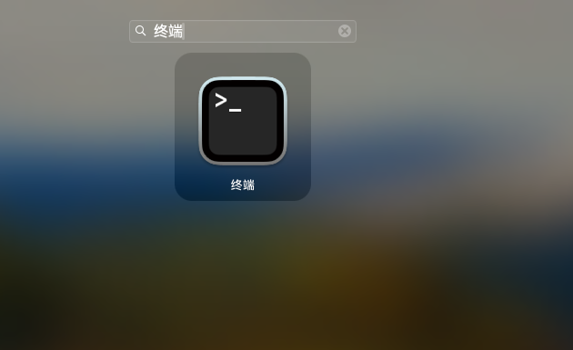
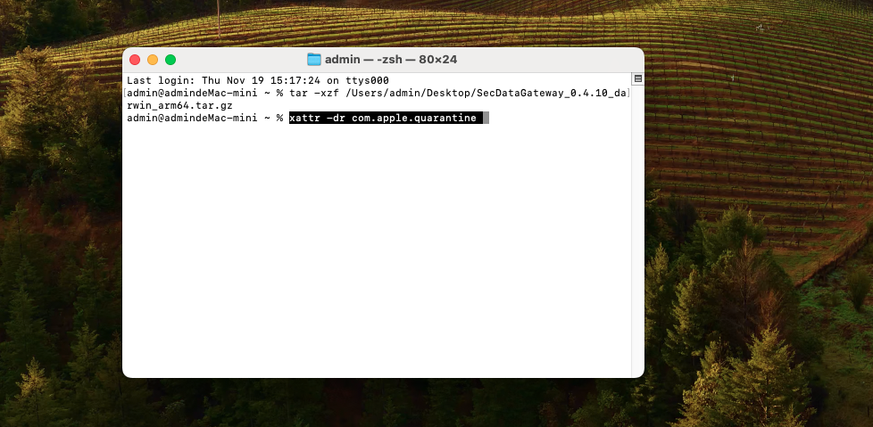
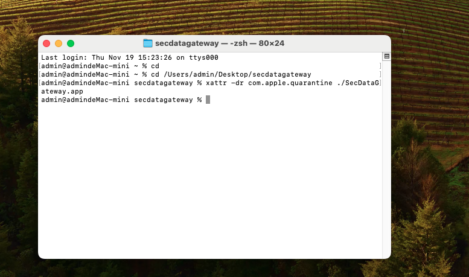
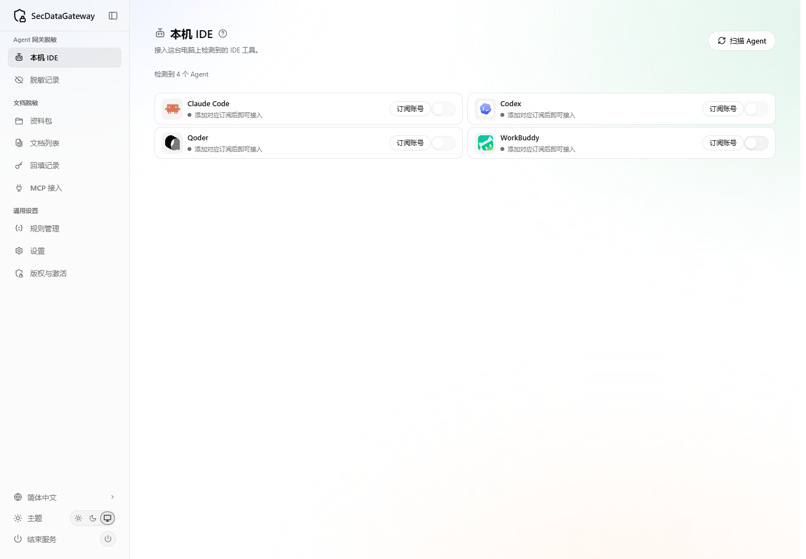
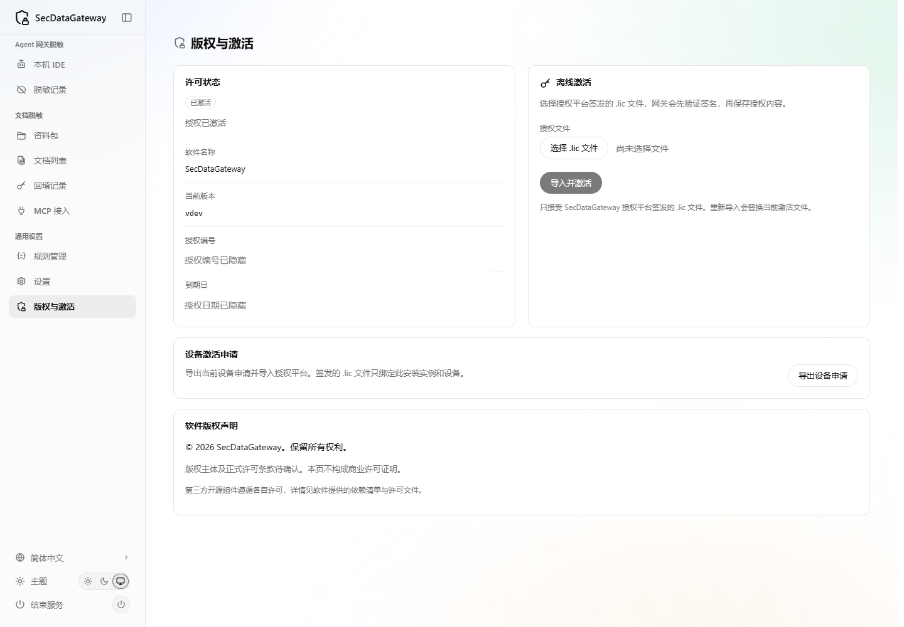
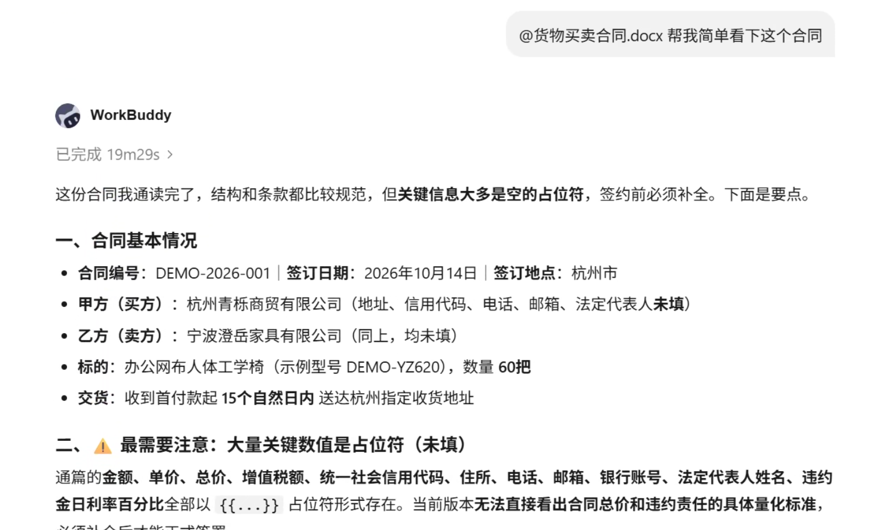
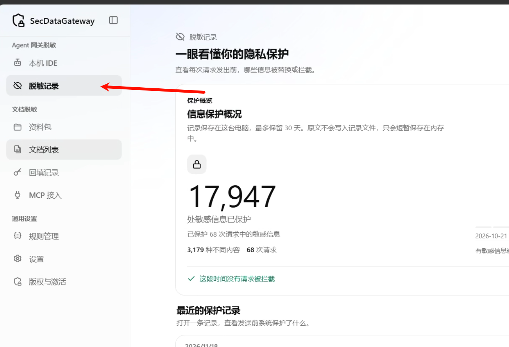

# SecDataGateway Mac 電腦操作手冊

從安裝啟動到接入工具與授權激活

介紹 Mac 上安裝啟動、接入 IDE 與版權激活；末尾附脫敏驗證示例。

## 第一章 Mac 安裝與啟動

提示無法驗證時，先移除安裝包隔離標記（僅針對該應用，不影響系統安全）。

### 1.1 下載安裝包

按芯片選安裝包：M 系列選 darwin_arm64，Intel 選 darwin_amd64。

發佈頁地址：https://github.com/lbxdorz/SecDataGateway-releases/releases

*圖1 軟件發佈頁：Apple 芯片 Mac 選擇 darwin_arm64 安裝包*

### 1.2 解壓安裝包

下載完成後，桌面上會出現 tar.gz
壓縮包；解壓到專用檔案夾，解壓後應能在檔案夾內看到 SecDataGateway.app。

*圖2 下載完成後桌面上的 tar.gz 壓縮包*

### 1.3 打開終端

按 Command＋空格調出聚焦搜索，輸入「終端」並打開應用程序。

*圖3 在聚焦搜索中打開「終端」*

### 1.4 解壓並移除隔離標記

在終端輸入 cd（注意末尾有一個空格），把包含 SecDataGateway.app
的檔案夾拖到終端窗口，按 Return 切換到該目錄；再依次執行：

> tar -xzf \<安裝包路徑\>
>
> xattr -dr com.apple.quarantine ./SecDataGateway.app

*圖4 終端中解壓安裝包並輸入隔離標記命令*

*圖5 終端中完成隔離標記移除命令*

### 1.5 啟動網關

Finder 中雙擊 SecDataGateway.app 啟動。

## 第二章 接入本機 IDE

先安裝並登錄 IDE，再按步驟接入網關：

> **1. 點「掃描」，查看已安裝的 IDE。**
>
> **2. 展開目標 IDE，新增訂閱賬號並登錄。**
>
> **3. 勾選可用模型，取消不需要的，點「保存選擇」。**
>
> **4. 打開接入開關，在 IDE 中選網關模型使用。**

*圖6 本機 IDE：掃描已安裝應用，新增訂閱後打開接入開關*

訂閱與模型按 IDE 分開；關閉或移除後配置恢復，已保存選項保留。

## 第三章 版權與激活

未授權時：導出設備申請檔 → 取得綁定設備的 .lic →
在「離線激活」導入，成功後菜單開放。

申請檔僅供簽發授權，請勿外發；換電腦或重裝需重新申請。

*圖7 版權與激活：導出設備申請，或導入授權平臺簽發的 .lic 檔案*

### 3.1 取得授權檔

請向軟件供應商取得綁定本機設備的 `.lic` 授權檔，並在「版權與激活」頁自行上傳導入。本線上手冊不附帶授權檔，也不提供公用授權。

## 附錄 脫敏結果驗證與示例

### 驗證脫敏是否成功

以匯出的交付檔為準；預覽檔僅供複覈。

發佈前先完成以下複覈：

- **逐條確認：要隱藏選「脫敏」，否則選「保留」；漏掉的手動補標記。**

- **逐頁檢查表格、頁眉頁腳、金額、聯繫方式、掃描件，無遺漏也無誤脫敏。**

- **核對遮罩／佔位符，修改保存後再「發佈」。**

匯出後，按下表逐項驗收：

| **檢查項**   | **做法**                                                                            | **合格標準**                             |
|--------------|-------------------------------------------------------------------------------------|------------------------------------------|
| 敏感詞檢索   | 在匯出檔中搜尋姓名、公司、帳號、手機號、郵箱、IP、證件號、金額等                    | 明文 0 命中，僅剩佔位符（如 PERSON_001） |
| 前後比對     | 脫敏前樣本與匯出檔逐條對照                                                          | 敏感字段已替換，非敏感信息保持原樣       |
| 隱藏信息     | 查文檔屬性/作者、批註、修訂記錄、頁眉頁腳、文本框、註解、元數據；PDF 另查圖層與附件 | 無殘留明文                               |
| 換形式再看   | 另存純文本/PDF、複製到記事本、解開 Word 讀 XML                                      | 仍挖不到原文                             |
| 圖片與掃描件 | 放大檢查或走 OCR                                                                    | 圖中敏感文字同樣已處理                   |
| 佔位符映射   | 核對 Word 稿佔位符編號完整、可對應回填                                              | 脫敏稿本身不含原文                       |
| 記錄留痕     | 在「脫敏記錄」查看文件狀態                                                          | 已發佈、處理完成，記錄可查               |

合格標準：敏感信息無明文；業務信息可讀；屬性、批註、隱藏層無殘留；僅含佔位符，回填外不可還原。

下圖為 AI 工具收到的脫敏稿：業務內容可讀，金額、賬號、信用代號等以
{{...}} 佔位，原文不外泄。

*圖8 接入網關的 AI*
工具收到的脫敏稿：金額、賬號、信用代號等敏感欄位以佔位符 {{...}}
呈現，原文不外泄

*圖9 脫敏記錄：已保護 17,947 處敏感信息、68 次請求，期間無請求被攔截*

---

[返回手冊首頁](../index.md) · [Windows](../windows/) · [Mac](../mac/) · [下載安裝包](https://github.com/lbxdorz/SecDataGateway-releases/releases) · [AI 安裝說明（README）](https://github.com/lbxdorz/SecDataGateway-releases/blob/main/README.zh-Hant.md)
